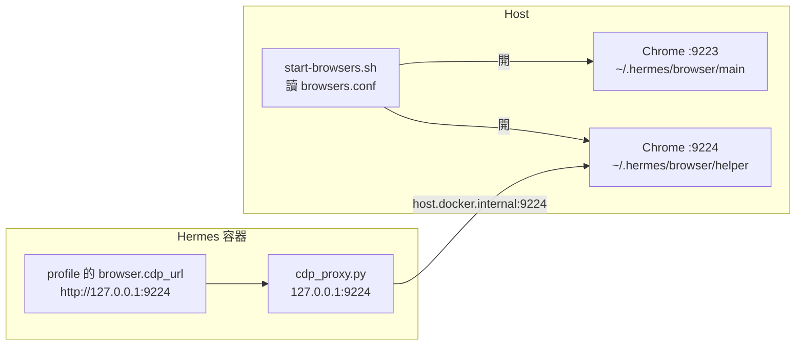

# 瀏覽器：接 Host 上已登入的 Chrome

讓容器裡的 Hermes 操作 host 上已登入的 Chrome。支援 macOS；Windows 未實測；Linux 尚未支援，見 [Linux](#linux)。不需要登入狀態時，也可以改用容器內 Chromium、雲端瀏覽器或 Camofox，見[其他瀏覽器後端](#其他瀏覽器後端)。

## 架構



- **`browsers.conf`**：repo 根目錄的 `port:profile_name` 清單，host 和容器共用。`./hermes-run.sh up` 每次把它複製到 data dir 的 `scripts/host/browsers.conf`。
- **[`start-browsers.sh`](../start-browsers.sh)**：在 host 上依清單每行開一個 Chrome，綁 `--remote-debugging-port=<port>`，登入狀態存在 `<BROWSER_DATA_DIR>/<profile_name>/user-data`。Chrome 路徑和資料目錄見[平台設定](setup.md#平台設定)。
- **[`cdp_proxy.py`](../scripts/cdp_proxy.py)**：隨 gateway 啟動，為清單裡每個 port 在容器的 `127.0.0.1:<port>` 開 listener，原封不動轉到 `CDP_HOST:<port>`（預設 `host.docker.internal`，Docker Desktop 會把它指到 host）。
- **[`docker/bin/agent-browser`](../docker/bin/agent-browser)**：image 裡的 wrapper，見 [agent-browser](#agent-browser)。

`browser.cdp_url` 要寫 `http://127.0.0.1:<port>`，不寫 `host.docker.internal`：Chrome 的 DNS-rebinding 檢查只放行 `Host` header 是 `127.0.0.1` 或 `localhost` 的連線。

多個 home 時每個容器各有自己的 `cdp_proxy.py`，listener 在各自的 loopback 上，可以接同一組 host port。

> [!WARNING]
> CDP 沒有認證，能連到這些 port 的程式都能完全操控對應的 Chrome 與它登入的帳號。這套接線只適合本機使用。

## 設定步驟

1. 建立 `browsers.conf`，一個 Chrome 帳號一行：

    ```bash
    cp browsers.conf.example browsers.conf
    ```

    每行一個 `port:profile_name`：

    ```text
    9223:main
    9224:helper
    ```

    - `#` 開頭的行與空行會被忽略，但不支援行尾註解：`9223:main # x` 會讓 profile 名稱變成 `main # x`。
    - `BROWSERS_CONFIG=/path/to/other.conf ./start-browsers.sh` 只換 host 端的清單；`hermes-run.sh` 只同步 repo 根目錄的 `browsers.conf`，容器內的轉發不會跟著換。

2. 開 Chrome：

    ```bash
    ./start-browsers.sh            # 等同 start
    ./start-browsers.sh status
    ./start-browsers.sh stop
    ./start-browsers.sh restart
    ```

    - 已在 listen 的 port 會跳過，重複執行不會多開。
    - `start` 會等每個 port 開始 listen（最多 15 秒）才回報 `[ok]` 或 `[fail]`。
    - `stop` 只砍命令列帶 `remote-debugging-port=<port>` 的 process，不影響你平常用的 Chrome。
    - 腳本帶了關閉背景節流的旗標，讓視窗被遮住時 CDP 仍能操作，原因見 [cron 的瀏覽器任務跑到一半停住](troubleshooting/cron-chrome-occlusion-stall.md)。

3. 第一次登入

    第一次開的 profile 是全新空白的 Chrome（腳本會印 `user-data-dir 不存在` 的 warn）。在那個 Chrome 視窗手動登入要用的網站，之後登入狀態留在 `<BROWSER_DATA_DIR>/<profile_name>/user-data`，重開也還在。

4. 啟動容器：`./hermes-run.sh up`。容器已在跑時改了 `browsers.conf`，要 `./hermes-run.sh up && ./hermes-run.sh restart`：`cdp_proxy.py` 只在啟動時讀一次清單。

5. 設定每個 Hermes profile 接哪個 Chrome：

    ```bash
    ./hermes-run.sh cli config set browser.cdp_url http://127.0.0.1:9223
    ./hermes-run.sh cli -p helper config set browser.cdp_url http://127.0.0.1:9224
    ```

    `config.example.yaml` 預設是 `http://127.0.0.1:9223`。profile 的建立方式見 [Agent、Home 與 Profile](agents-and-profiles.md)。

6. 驗證連線：

    ```bash
    ./start-browsers.sh status                                # host：Chrome 有在 listen
    ./hermes-run.sh cli -p helper config get browser.cdp_url  # 這個 profile 接哪個 port
    docker exec hermes curl -s http://127.0.0.1:9224/json/version
    ```

    最後一行從容器內經 `cdp_proxy.py` 打 Chrome 的 `/json/version`，回 JSON 就代表整條路通了；失敗時的判讀見[常見錯誤](#常見錯誤)。容器名稱預設是 `hermes`（`HERMES_CONTAINER_NAME`），其他 home 換成它的容器名稱。

## 兩種瀏覽器工具

| | `browser_exec`（Hermes 內建） | `agent-browser --cdp <port>` |
| --- | --- | --- |
| 接哪個 Chrome | 目前 profile 的 `browser.cdp_url`，一個 profile 一個 | 每個指令用 `--cdp` 指定 |
| 操作方式 | 模型寫一段 Python，由 Browser Use harness 透過 CDP 執行；helper 如 `goto_url`、`js`、`fill_input`、`capture_screenshot` | 一行一個指令，如 `open`、`snapshot -i`、`click @eN`、`fill` |
| 適合 | 一般瀏覽、需要寫邏輯的抓取 | skill 與 cron 的固定流程，或同一個 agent 要接多個 Chrome |

`browser_exec` 的 CDP endpoint 依下列順序決定，三者都以 Hermes profile 為單位：

1. 執行中以 `/browser connect` 連上的 endpoint。這是互動式 CLI 指令，gateway 不會執行，Discord、DingTalk、cron 與 `chat -q` 都用不到。
2. 環境變數 `BROWSER_CDP_URL`。
3. `browser.cdp_url`。

### agent-browser

由 agent 透過 terminal tool 執行。容器裡的 `agent-browser` 是一支 wrapper，替它做兩件事：

- **依 port 分 session**：agent-browser 的背景 daemon 只認第一次連上的 port，之後的 `--cdp` 不生效。wrapper 在呼叫端沒指定 session 時，自動用 `cdp-<port>` 當 session 名稱，不同 port 的工作不會操作到同一個 Chrome。
- **找到 Hermes 附帶的 Chromium**：路徑每個 Hermes 版本都不同，wrapper 從 `/etc/hermes/chromium-executable-path` 讀。

使用時：

- 每個指令都要帶 `--cdp <port>`，少了它會在容器內另開一個沒登入的 headless Chromium。
- `close` 只斷線，不會關掉 host 上的 Chrome。

## 多帳號：一個 Chrome 帳號對應一個 profile

`browser_exec` 一個 profile 只能接一個 Chrome，也沒辦法讓每個 skill 或 cron 各自指定。從 script 匯出 `BROWSER_CDP_URL` 也沒用：同一個容器跑多個 profile 時，非啟動的 profile 只讀自己的 `.env`，不讀 process 的環境變數（`/opt/hermes/tools/browser_session_cdp.py` 的 `env_cdp_url`）。所以把帳號綁在 profile 上，一個 Chrome 帳號在 `browsers.conf` 佔一行，對應一個 Hermes profile：

```text
script 的 -p <profile> → 該 profile 的 browser.cdp_url → port → 登入某帳號的 Chrome
```

skill 用 `agent-browser` 時不要寫死 port，先讀目前 profile 的設定再帶進每個指令：

```bash
hermes config get browser.cdp_url    # 例如 http://127.0.0.1:9224
agent-browser --cdp 9224 open https://example.com
agent-browser --cdp 9224 snapshot -i
```

這樣同一份 skill 在不同 profile 下會操作不同帳號的 Chrome，`browser_exec` 與 `agent-browser` 也接到同一個 Chrome。

## 其他瀏覽器後端

`browser` toolset 預設已啟用，`./hermes-run.sh cli tools list --platform discord` 可以確認。`browser_exec` 依下列順序決定用哪個瀏覽器：

1. CDP endpoint（`/browser connect`、`BROWSER_CDP_URL`、`browser.cdp_url`）
2. 私有網址交給容器內 Chromium，見[私有網址走容器內 Chromium](#私有網址走容器內-chromium)
3. `browser.cloud_provider` 指定的雲端瀏覽器，建立 session 失敗時改用容器內 Chromium
4. 容器內 Chromium

`config.example.yaml` 預設 `browser.cdp_url` 是 `http://127.0.0.1:9223`，會蓋過容器內 Chromium 與雲端瀏覽器的設定，所以先清空：

```bash
./hermes-run.sh cli config set browser.cdp_url ""
```

金鑰寫在 `<data dir>/.env`，其他 profile 寫在 `<data dir>/profiles/<名稱>/.env`；`config set` 對其他 profile 加 `-p <profile>`。改完重啟 gateway：

```bash
./hermes-run.sh cli gateway restart
```

更多選項見[官方 Browser 文件][official]。

### 容器內 Chromium

image 已內建 Chromium，不需要金鑰。開的是沒有登入狀態的 headless 瀏覽器，每個 session 都是新的。

1. 設定：

    ```bash
    ./hermes-run.sh cli config set browser.cdp_url ""
    ./hermes-run.sh cli config set browser.cloud_provider local
    ```

2. 確認：`./hermes-run.sh cli doctor` 的輸出裡 `Chromium` 那一列打勾，並列出 Chromium 路徑。

`docker-compose.yml` 已把 `shm_size` 設為 `1g`（`HERMES_SHM_SIZE`），Chromium 需要較大的 `/dev/shm`，不要調低。

### Browserbase

1. 到 [browserbase.com](https://browserbase.com) 取得 API key 與 project ID，寫進 `<data dir>/.env`：

    ```ini
    BROWSERBASE_API_KEY=...
    BROWSERBASE_PROJECT_ID=...
    ```

    選用：

    - `BROWSERBASE_PROXIES`：residential proxy，預設 `true`
    - `BROWSERBASE_ADVANCED_STEALTH`：進階隱匿模式，預設 `false`
    - `BROWSERBASE_KEEP_ALIVE`：保持 session，預設 `true`
    - `BROWSERBASE_SESSION_TIMEOUT`：session timeout，單位毫秒

    方案不支援 keep-alive 或 proxy 時（API 回 402），Hermes 會拿掉該功能重試。

2. 設定：

    ```bash
    ./hermes-run.sh cli config set browser.cloud_provider browserbase
    ```

3. 確認：`./hermes-run.sh cli status --full` 的 `API Keys` 段落裡 `Browserbase` 打勾。

### Browser Use

1. 到 [browser-use.com](https://browser-use.com) 取得 API key，寫進 `<data dir>/.env`：

    ```ini
    BROWSER_USE_API_KEY=...
    ```

2. 設定：

    ```bash
    ./hermes-run.sh cli config set browser.cloud_provider browser-use
    ```

3. 確認：`./hermes-run.sh cli status --full` 的 `API Keys` 段落裡 `Browser Use` 打勾。

### Firecrawl

1. 到 [firecrawl.dev](https://firecrawl.dev) 取得 API key，寫進 `<data dir>/.env`。這把 key 也給 Firecrawl 網頁搜尋用：

    ```ini
    FIRECRAWL_API_KEY=...
    ```

    選用：

    - `FIRECRAWL_API_URL`：自架 Firecrawl 的位址，預設 `https://api.firecrawl.dev`
    - `FIRECRAWL_BROWSER_TTL`：session 存活秒數，預設 `300`

2. 設定。Firecrawl 只在明確指定時使用：

    ```bash
    ./hermes-run.sh cli config set browser.cloud_provider firecrawl
    ```

3. 確認：`./hermes-run.sh cli status --full` 的 `API Keys` 段落裡 `Firecrawl` 打勾。

### Camofox

[Camofox](https://github.com/jo-inc/camofox-browser) 是反偵測的 Firefox（Camoufox）包成的 REST server。它已移出 Hermes 核心，改成官方 plugin，提供 `camofox` toolset（`browser_navigate`、`browser_click` 等），不經過 `browser_exec`。Hermes 不會幫你安裝或啟動 server。

1. 在 host 上啟動 Camofox server：

    ```bash
    docker run -d -p 9377:9377 -e CAMOFOX_PORT=9377 ghcr.io/jo-inc/camofox-browser:latest
    ```

2. 安裝 plugin，裝在 data dir 的 `plugins/camofox`：

    ```bash
    ./hermes-run.sh cli plugins install camofox
    ```

3. 把 server 位址寫進 `.env`。從容器連 host 要用 `host.docker.internal`；API key 可留空：

    ```bash
    ./hermes-run.sh cli camofox setup --url http://host.docker.internal:9377
    ```

    結果是 `<data dir>/.env` 多一行 `CAMOFOX_URL=http://host.docker.internal:9377`。

4. 啟用 toolset。`--platform` 不寫時只套用到 CLI：

    ```bash
    ./hermes-run.sh cli tools enable camofox --platform discord
    ```

    要讓 agent 只走 Camofox，再關掉 `browser`：`./hermes-run.sh cli tools disable browser --platform discord`。

5. 要保留 cookie 與登入狀態，在 `config.yaml` 開 persistent session（server 端也要把這個 profile 對應到持久的 Camofox profile）：

    ```yaml
    browser:
      camofox:
        managed_persistence: true
    ```

6. 確認：`./hermes-run.sh cli camofox status` 列出 server 位址、身分模式，以及 server 連不連得到。

### 私有網址走容器內 Chromium

用雲端瀏覽器時，`localhost`、區網等私有網址雲端連不到，Hermes 會改用容器內 Chromium 開，公開網址照樣走雲端。這由 `browser.auto_local_for_private_urls` 控制，預設 `true`；設成 `false` 則直接拒絕私有網址：

```bash
./hermes-run.sh cli config set browser.auto_local_for_private_urls false
```

## 常見錯誤

### `browser_exec` 報 `BU_CDP_URL=... unreachable after 30s`

`cdp_url` 對應的 Chrome 連不上時，`browser_exec` 等 30 秒後直接失敗，不會退回容器內的 Chromium（訊息來自 `browser_harness/daemon.py`）。依序檢查：

1. `./start-browsers.sh status`：Chrome 有沒有在跑。
2. 該 port 在不在 `browsers.conf`：不在的話加進去，再 `./hermes-run.sh up && ./hermes-run.sh restart`。
3. `./hermes-run.sh cli -p <profile> config get browser.cdp_url`：port 對不對。

### 驗證連線的 `curl` 失敗

從容器內 `curl http://127.0.0.1:<port>/json/version` 的失敗方式可以分出斷在哪一段：

- **`Connection reset by peer`**：`cdp_proxy.py` 有在轉發這個 port，但 host 上的 Chrome 沒在 listen。`cdp_proxy.py` 接受連線後連不上 host 就把連線關掉。到 host 跑 `./start-browsers.sh`。
- **連線被拒（curl exit code 7）**：容器內沒有人 listen 這個 port，也就是它不在容器啟動時讀到的 `browsers.conf` 裡。
- **`Failed to bind <port>`**（`cdp_proxy.py` 的 log）：容器內已經有程式佔用這個 port，通常是另一支轉發站已在跑。

### `agent-browser` 抓到登入牆或資料變少

某個指令少帶了 `--cdp`，跑在容器內沒登入的 Chromium 上；或 Chrome 的登入過期，到那個視窗重新登入。

### 臨時接一個不在 `browsers.conf` 的 port

在容器內背景執行 `python3 /opt/data/scripts/cdp_proxy.py <port>`。不要終止隨 gateway 啟動的那支，它是所有 profile 共用的。

### 背景 cron 跑到一半卡住

見 [cron 的瀏覽器任務跑到一半停住](troubleshooting/cron-chrome-occlusion-stall.md)。

## Linux

尚未支援。compose 已經讓容器在 Linux 上也解析得到 `host.docker.internal`，但 Chrome 的 `--remote-debugging-port` 只聽 host 的 `127.0.0.1`，從容器連過去會被拒絕。Docker Desktop 會把連線轉到 host 的 localhost，所以 macOS 沒有這個問題。要支援 Linux，得在 host 上另外把 debug port 轉出來。

[official]: https://hermes-agent.nousresearch.com/docs/user-guide/features/browser
